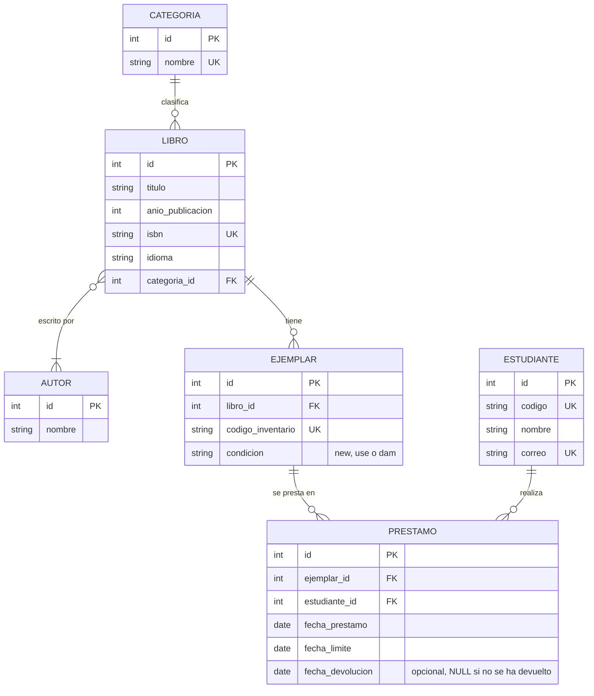

# Biblioteca Django

Es una herramienta que permitirá organizar los prestamos de la biblioteca de una universidad, automatizando el proseso de los mismos permitiendo saber que libros estan disponibles, cuales estan por proximos a venser su fecha de devolución y que estudiante solisitó el prestamo.

# Tecnologías 

- **Versión de Python:** Python 3.15.2
- **Versión de Django:** 6.1.3
- **Base de datos:** SQLite (la que trae Django por defecto). El archivo db.sqlite3 no se sube al repositorio: se crea al ejecutar python manage.py migrate
- **Versión de SQLite:** 3.53.4

## Instalación y ejecución

Requisitos previos: tener instalados [Python](https://www.python.org/downloads/) y [Git](https://git-scm.com/).

1. **Clonar el repositorio y entrar a la carpeta:**
   ```bash
   git clone https://github.com/MariaBeco/BibliotecaDjango.git
   cd BibliotecaDjango
   ```

2. **Crear y activar el entorno virtual.** Así las librerías del proyecto quedan aisladas de las del resto del computador.
   ```bash
   python -m venv venv
   ```
   - Windows (PowerShell): `.\venv\Scripts\activate`
   - Linux / macOS: `source venv/bin/activate`

   Sabrás que está activo porque la terminal empieza con `(venv)`.

3. **Instalar las dependencias** (Django y lo que necesita):
   ```bash
   pip install -r requirements.txt
   ```

4. **Crear la base de datos.** Aplica las migraciones y crea el archivo `db.sqlite3` con todas las tablas:
   ```bash
   python manage.py migrate
   ```

5. **Crear un usuario administrador** para entrar al panel. Pide usuario, correo (opcional) y contraseña:
   ```bash
   python manage.py createsuperuser
   ```

6. **Arrancar el servidor de desarrollo:**
   ```bash
   python manage.py runserver
   ```

7. **Abrir en el navegador** http://127.0.0.1:8000/admin/ e ingresar con el usuario del paso 5.

Para detener el servidor, presiona `Ctrl + C` en la terminal.

## Estructura del proyecto

```
BibliotecaDjango/
├── config/                  # configuración general del proyecto
│   ├── settings.py          # lista de apps instaladas y base de datos que utiliza
│   └── urls.py              # directorio de páginas
├── biblioteca/              # app con la lógica de la biblioteca
│   ├── models.py            # modelos de la app
│   ├── admin.py             # configuración del panel de administración (/admin)
│   ├── migrations/          # archivos que generó django con makemigrations, es el historial de cambios de la base de datos
│   └── management/commands/
│       └── cargar_datos.py  # llena la base de datos con datos de prueba
├── manage.py                # administrador del proyecto
├── requirements.txt         # versiones de asgiref, Django, sqlparse, tzdata
├── .gitignore               # archivos que no deben subirse a GitHub
└── README.md                # Aquí estas :D
```
Los demás archivos los genera Django automáticamente.

**Modelo de datos**

# DIAGRAMA DE RELACIONES



**Entidades:** Categoría, Autor, Libro, Ejemplar (copia física), Estudiante, Préstamo. 
**Campos:**
| Modelo | Campos |
|---|---|
| Categoria | nombre (único) |
| Autor | nombre |
| Libro | titulo, anio_publicacion, isbn (único), categoria, autores |
| Ejemplar | libro, codigo_inventario (único), condicion (nuevo/usado/dañado) |
| Estudiante | codigo (único), nombre, correo (único) |
| Prestamo | ejemplar, estudiante, fecha_prestamo, fecha_limite, fecha_devolucion (puede estar vacía) |

**Relaciones:**
| Par | Tipo | Dónde se escribe | on_delete y por qué |
|---|---|---|---|
| Categoría y Libro | 1 a muchos | `ForeignKey` en Libro | `PROTECT`: no dejar borrar una categoría que tiene libros |
| Libro y Autor | muchos a muchos | `ManyToManyField` en Libro | no aplica (Django crea la tabla intermedia `biblioteca_libro_autores`) |
| Libro y Ejemplar | 1 a muchos | `ForeignKey` en Ejemplar | `CASCADE`: si el libro desaparece del catálogo, sus copias no tienen sentido |
| Ejemplar y Préstamo | 1 a muchos | `ForeignKey` en Préstamo | `PROTECT`: no perder el historial de préstamos |
| Estudiante y Préstamo | 1 a muchos | `ForeignKey` en Préstamo | `PROTECT`: no se puede borrar un estudiante con historial |


- **Libro y Ejemplar** Porque el título, ISBN y autores son del libro y se repiten igual en todas las copias. Si fuera un solo modelo, con 3 copias tendrías 3 filas con el mismo título e ISBN repetidos (y el ISBN ya no podría ser único). Además se presta la copia, no el libro.
- **fecha real de devolución** En el Préstamo (`fecha_devolucion`). Mientras el libro sigue prestado vale **NULL** (vacío). Por eso lleva `null=True, blank=True`. "Préstamo activo" = préstamo con `fecha_devolucion` vacía.
- **on_delete entre préstamo y estudiante** `PROTECT`. Si fuera `CASCADE`, borrar un estudiante borraría su historial de préstamos y la biblioteca perdería el registro de quién tuvo qué libro.

**La regla de la copia prestada**
Elegimos una **restricción en la base de datos** (`UniqueConstraint` con condición): "solo puede haber un préstamo **sin fecha de devolución** por cada ejemplar".
la base de datos la hace cumplir siempre, sin importar si el préstamo se guarda desde el admin, desde el shell con `.save()` o desde un script. Con `clean()` la regla se salta si alguien guarda con `.save()` sin llamar `full_clean()`. Además, desde Django 4.1 el admin también valida las constraints, así que la bibliotecaria ve un mensaje claro en el formulario en vez de un error feo.

**Al probar la restricción**

Para probar la restricción se hizo a través de shell de Django. Primero se obtuvieron los datos que necesitábamos de la base de datos, la copia CIEN-001 y a la estudiante Ana:
```python
from biblioteca.models import Ejemplar, Estudiante, Prestamo
from datetime import date
copia = Ejemplar.objects.get(codigo_inventario="CIEN-001")
ana = Estudiante.objects.get(codigo="1152001")
```

Al querer crear un nuevo préstamo con la copia que ya se encontraba en otro préstamo activo:
```python
Prestamo.objects.create(ejemplar=copia, estudiante=ana, fecha_prestamo=date.today(), fecha_limite=date(2026, 12, 6))
```
la base de datos lanzó el siguiente error:
```
sqlite3.IntegrityError: UNIQUE constraint failed: biblioteca_prestamo.ejemplar_id
```

Este error prueba que la regla funciona y la base de datos no guardó el préstamo. Para finalizar, se le asignó la fecha de hoy como la fecha de devolución del préstamo que tenía la copia de la prueba:
```python
p = Prestamo.objects.get(ejemplar=copia, fecha_devolucion__isnull=True)
p.fecha_devolucion = date.today()
p.save()
```
y de nuevo, se probó crear el préstamo con esa copia para la estudiante Ana, el cual se realizó exitosamente mostrando:
```
<Prestamo: copia:CIEN-001 - estudiante:1152001 - (activo)>
```

**Lectura del SQL de la migración inicial**

Revisamos el SQL con `python manage.py sqlmigrate biblioteca 0001`.

- **Nombres de las tablas:** Django nombra cada tabla como `nombreapp_nombremodelo`, en minúscula. Por ejemplo, el modelo `Prestamo` se convierte en la tabla `biblioteca_prestamo`.
- **Tabla intermedia del muchos a muchos:** aparece como `biblioteca_libro_autores`, aunque no escribimos ningún modelo para ella. Django la crea a partir del `ManyToManyField` de `Libro`, porque una sola columna no puede guardar una lista de autores. Tiene dos columnas, `libro_id` y `autor_id`, y cada fila representa un par "este libro fue escrito por este autor".
- **Llaves foráneas:** cada `ForeignKey` se convierte en una columna con el nombre del campo más `_id`. Por ejemplo, `categoria` queda como `categoria_id`, que guarda el id de la categoría. El `REFERENCES "biblioteca_categoria"` indica que ese valor debe corresponder a una categoría existente.
- **Campos opcionales:** `fecha_devolucion` aparece como `date NULL` (puede quedar vacía) porque la definimos con `null=True`, mientras que `fecha_limite` aparece como `NOT NULL` (obligatoria).
- **Regla de la copia prestada:** aparece como `CREATE UNIQUE INDEX "una_copia_un_prestamo_activo" ... WHERE "fecha_devolucion" IS NULL`. 
- **WHERE** hace que la regla solo se aplique a los préstamos cuya fecha de devolución está vacía, es decir, a los préstamos activos. Así, una copia no puede tener dos préstamos activos al mismo tiempo, pero sí puede volver a prestarse después de ser devuelta.

- la migración es la 0002, la operación es AddField (agregar un campo a libro), Django preguntó por un valor por defecto porque ya había libros sin idioma, elegiste la opción 1 con "Español", y preserve_default=False hace que ese valor solo se use para los libros existentes.

## 6. Panel de administración

El panel de administración se personalizó pensando en una bibliotecaria que no tiene conocimientos técnicos y que registra préstamos todos los días. La idea consistió en facilitar el acceso a la información para que fuera más rápido y que fuera difícil equivocarse al registrar un préstamo.

| Qué se personalizó | Qué necesidad de la bibliotecaria resuelve |
|---|---|
| Estudiante: columnas de código y nombre (`list_display`) y búsqueda por código o nombre (`search_fields`) | Al llegar un estudiante a pedir un libro pueda encontrarlo rapidamente escribiendo su nombre o código.
| Libro: columnas de título, ISBN, categoría y año (`list_display`) | Ve los datos principales de cada libro sin tener que abrirlo. |
| Libro: búsqueda por título, ISBN o nombre del autor (`search_fields`) | Si alguien pregunta por un autor, puede escribir su nombre y ver todos sus libros. |
| Libro: filtros por categoría, autor y año (`list_filter`) | Puede seleccionar ver solo los libros de una categoria y/o solo los de un autor con un clic. |
| Libro: las copias aparecen dentro de la página del libro (`inlines`) | Ve cuántas copias tiene cada libro y puede agregar una nueva desde el mismo lugar. |
| Ejemplar: búsqueda por código de inventario o título (`search_fields`) y filtros por condición y categoría (`list_filter`) | Puede encontrar una copia por el código de la etiqueta, o ver que libros estan en cierto estado. |
| Préstamo: columna "Devuelto" con ✔ o ✘ (`list_display`) | Saber al instante qué préstamos siguen sin devolverse. |
| Préstamo: filtro por fecha de devolución (`list_filter`) | Con un clic en "Sin fecha" ve solo los préstamos activos. |
| Préstamo: búsqueda por código o nombre del estudiante, código de la copia o título del libro (`search_fields`) | Puede encontrar rápido el préstamo de un estudiante o de un libro en particular. |
| Préstamo: buscador al elegir la copia y el estudiante (`autocomplete_fields`) | En vez de bajar por una lista larga, escribe parte del título o del código y elige la copia correcta. |
| Préstamo: acción "Marcar como devueltos" (`actions`) | Si le devuelven varios libros a la vez, los selecciona y los marca todos con la fecha de hoy en un solo paso. |
| `__str__` legible en todos los modelos | En las listas y en los formularios ve los nombres, como "Cien años de soledad - CIEN-001 - Usado", en vez de "Ejemplar object (1)". |

**Mini reto de la bibliotecaria**

- **Buscar un estudiante por código o por nombre:** se resolvió con la búsqueda en Estudiante.
- **Ver de un vistazo qué préstamos siguen sin devolverse:** se resolvió con la columna "Devuelto" (✔ o ✘) y el filtro por fecha de devolución.
- **Registrar un préstamo sin confundirse entre copias de libros distintos:** se resolvió con el buscador de copias (`autocomplete_fields`) y con el `__str__` de Ejemplar, que muestra el título del libro, el código de inventario y la condición de cada copia.
- **Marcar préstamos como devueltos:** se hizo con la acción "Marcar como devueltos", que solo cambia los préstamos que siguen activos, para no modificar la fecha de los que ya habían sido devueltos.


## 7. Consultas del ORM

Los retos 1 a 5 se hicieron después de probar el admin, por lo que algunos préstamos fueron devueltos y se crearon dos préstamos nuevos (CRON-001 para Ana y ARQ-001 para Carlos). Por eso sus resultados no coinciden con los datos originales de `cargar_datos`, que se usaron en los retos 6 a 10.

### Reto 1. Creación de un autor, libro de ese autor y dos ejemplares

**Código**
```python
autor = Autor.objects.create(nombre="Aldous Huxley")
categoria=Categoria.objects.create(nombre="ciencia ficción")
libro=Libro.objects.create(titulo="Un mundo feliz", anio_publicacion=1932,isbn="1234567890123",categoria=categoria,idioma="Inglés")
libro.autores.add(autor)
Ejemplar.objects.create(libro=libro, codigo_inventario="MUNDO-01", condicion="new")
Ejemplar.objects.create(libro=libro, codigo_inventario="MUNDO-002", condicion="new")
libro.autores.all()
libro
```

**Predicción**
La predicción es que al crear el autor este devuelva el nombre del autor creado, al crear el libro devuelva el título y año publicado, al crear las dos copias del libro cada una tendrá un código de inventario diferente.

**Resultado**
```
<Ejemplar: Un mundo feliz - MUNDO-01 - Nuevo>
<Ejemplar: Un mundo feliz - MUNDO-002 - Nuevo>
<QuerySet [<Autor: Aldous Huxley>]>
<Libro: Un mundo feliz (1932)>
```
**Comparación**
El resultado coincidio en cierta parte, ya que las copias sí mostraron el resultado como se esperaba pero el autor y el libro no porque sus valores se guardaron en variables, el shell solo muestra el resultado cuando no se guarda en una variable. Igualmente, se comprobó que estos se crearon correctamente.

---
### Reto 2. Todos los libros de un autor

**Código**
```python
autor2=Autor.objects.get(nombre="Robert C. Martin")
autor2.libro_set.all()
```

**Predicción**
Se espera que devuelva la lista de libros que pertenecen al autor indicado, en este caso "Robert C. Martin".

**Resultado**
```
<QuerySet [<Libro: Clean Code (2008)>, <Libro: Clean Architecture (2017)>]>
```

**Comparación**
El resultado coincide con lo esperado: el QuerySet devuelve los 2 libros de ese autor, Clean Code y Clean Architecture.

---
### Reto 3. Obtener libros que coincidan con cierta palabra

**Código**
```python
Libro.objects.filter(titulo__icontains="de")
```

**Predicción**
Se espera que el QuerySet devuelva la lista de libros que contenga la palabra dada en la condición independiente si está en mayúscula o en minúscula.

**Resultado**
```
<QuerySet [<Libro: Cien años de soledad (1967)>, <Libro: Crónica de una muerte anunciada (1981)>, <Libro: Clean Code (2008)>]>
```

**Comparación**
El QuerySet coincidió en parte con lo esperado. Al utilizar el filtro aplicado al título de los libros, este devolvió los libros que contenían "de" independiente si estuviera en mayúscula o minúscula: Cien años de soledad, Crónica de una muerte anunciada y Clean Code. Sin embargo, Clean Code no tiene la palabra "de", sino que aparece porque "Code" contiene esas letras. Esto muestra que `icontains` no busca palabras completas, sino el texto en cualquier parte del título.

---
### Reto 4. Obtener ejemplares disponibles

**Código**
```python
activos = Prestamo.objects.filter(fecha_devolucion__isnull=True)
Ejemplar.objects.exclude(prestamo__in=activos)
```

**Predicción**
Se espera que el QuerySet devuelva los ejemplares que se encuentren disponibles.

**Resultado**
```
<QuerySet [<Ejemplar: Cien años de soledad - CIEN-001 - Usado>, <Ejemplar: Clean Code - CLEAN-001 - Nuevo>, <Ejemplar: Clean Code - CLEAN-002 - Dañado>, <Ejemplar: The Pragmatic Programmer - PRAG-001 - Usado>, <Ejemplar: The Pragmatic Programmer - PRAG-002 - Nuevo>, <Ejemplar: Un mundo feliz - MUNDO-01 - Nuevo>, <Ejemplar: Un mundo feliz - MUNDO-002 - Nuevo>]>
```

**Comparación**
El resultado coincide con lo esperado. Hay 10 ejemplares en total (8 de los datos de prueba y los 2 de "Un mundo feliz" creados en el reto 1) y 3 de ellos tienen un préstamo activo: CIEN-002, CRON-001 y ARQ-001. Por eso el QuerySet devuelve los 7 ejemplares restantes. CIEN-001, CLEAN-001 y PRAG-001 aparecen como disponibles porque ya tuvieron préstamos, pero todos fueron devueltos, y la consulta solo excluye los ejemplares con un préstamo sin fecha de devolución.

---
### Reto 5. Estudiantes con al menos un préstamo activo

**Código**
```python
activos = Prestamo.objects.filter(fecha_devolucion__isnull=True)
Estudiante.objects.filter(prestamo__in=activos).distinct()
```

**Predicción**
Se espera que el QuerySet devuelva los estudiantes que cuentan con un préstamo activo, donde se muestre su código, nombre y correo como está en su __str__, y en caso de tener varios préstamos solo salgan una vez en la lista.

**Resultado**
```
<QuerySet [<Estudiante: 1152003 - María Rojas - mariarojas@ufps.edu.co>, <Estudiante: 1152001 - Ana Pérez - anaperez@ufps.edu.co>, <Estudiante: 1152004 - Carlos Díaz - carlosdiaz@ufps.edu.co>]>
```

**Comparación**
El resultado coincidió con lo esperado: el QuerySet devolvió los estudiantes que tenían préstamos activos, con una sola aparición en la lista y mostrando los datos como están en su __str__. Los estudiantes fueron: María Rojas, Ana Pérez y Carlos Díaz. En este caso cada uno tenía solo un préstamo activo, por lo que `.distinct()` no tuvo que quitar repetidos; sí sería necesario si un estudiante tuviera dos o más préstamos activos.

---
### Reto 6. Préstamos por estudiante, contando los ya devueltos

**Código**
```python
from django.db.models import Count
[(e.nombre, e.total) for e in Estudiante.objects.annotate(total=Count("prestamo"))]
```

**Predicción**
Espero que a cada objeto Estudiante se le agregue una columna calculada llamada total, y que la función Count cuente cuántos préstamos tiene cada estudiante. Funciona como un GROUP BY por estudiante, cada uno aparece una sola vez con su cantidad. Como no filtramos por fecha de devolución, cuenta los devueltos y los activos, y Carlos, que no tiene préstamos, queda con 0.

**Resultado**
```
[('Ana Pérez', 2), ('Luis Gómez', 2), ('María Rojas', 3), ('Carlos Díaz', 0)]
```

**Comparación**
La predicción coincidió con el resultado.

---

### Reto 7. El libro más prestado

**Código**
```python
l = Libro.objects.annotate(total=Count("ejemplar__prestamo")).order_by("-total").first()
print(l, l.total)
```

**Predicción**
Espero que a cada objeto Libro se le agregue una columna calculada llamada total, y que la función Count cuente cuántos préstamos tiene cada libro, pasando primero por sus copias y luego por los préstamos de cada copia. Después se ordena de mayor a menor y se toma el primero. Espero que salga Cien años de soledad con 3 préstamos, porque entre sus dos copias suma más préstamos que cualquier otro libro. Cuenta los devueltos y los activos, y los libros sin préstamos quedan con 0.

**Resultado**
```
Cien años de soledad (1967) 3
```

**Comparación**
La predicción coincidió con el resultado.

---

### Reto 8. Estudiantes que nunca han pedido un préstamo

**Código**
```python
Estudiante.objects.filter(prestamo__isnull=True)
```

**Predicción**
Espero que devuelva solo a Carlos Díaz, porque es el único estudiante que no tiene ningún préstamo registrado. El filtro busca los estudiantes cuya relación con préstamo está vacía, así que los que tienen al menos un préstamo, activo o devuelto, no aparecen.

**Resultado**
```
<QuerySet [<Estudiante: 1152004 - Carlos Díaz - carlosdiaz@ufps.edu.co>]>
```

**Comparación**
La predicción coincidió con el resultado.

---

### Reto 9. Marcar un préstamo como devuelto

**Código**
```python
from datetime import date
p = Prestamo.objects.filter(fecha_devolucion__isnull=True).first()
print(p.fecha_devolucion)
p.fecha_devolucion = date.today()
p.save()
Prestamo.objects.get(id=p.id).fecha_devolucion
```

**Predicción**
Espero que antes del cambio la fecha de devolución sea None, porque el préstamo está activo, y que después de asignar la fecha de hoy y guardar con save, al leerlo de nuevo desde la base de datos aparezca la fecha de hoy. Volver a leerlo con get confirma que el cambio quedó guardado y no solo en memoria.

**Resultado**
```
None
datetime.date(2026, 11, 22)
```

**Comparación**
La predicción coincidió con el resultado esperado.

---

### Reto 10. Borrar un autor y ver qué pasa con sus libros

**Código**

Primero se crea un autor de prueba con un libro, para no borrar datos reales:
```python
autor, _ = Autor.objects.get_or_create(nombre="Autor Prueba")
libro, _ = Libro.objects.get_or_create(isbn="9780000000001", defaults=dict(titulo="Libro de prueba", anio_publicacion=2020, categoria=Categoria.objects.first(), idioma="Español"))
libro.autores.add(autor)
```
Luego se borra el autor y se revisa qué pasó con el libro:
```python
autor.libro_set.all()
Libro.objects.count()
autor.delete()
Libro.objects.count()
list(libro.autores.all())
```

**Predicción**
Espero que al borrar el autor la cantidad de libros siga igual, y que el libro quede con la lista de autores vacía. La relación entre libro y autor es de muchos a muchos, así que solo se borra el enlace en la tabla intermedia y los libros no se eliminan. El on_delete no aplica aquí, porque solo existe en las relaciones de tipo ForeignKey.

**Resultado**
```
<QuerySet [<Libro: Libro de prueba (2020)>]>
6
6
[]
```

**Comparación**
La predicción coincidió con el resultado esperado.

## 8. Optimización de consultas (problema N+1)

Para contar cuántas consultas ejecuta cada bloque se usó `CaptureQueriesContext`.

```python
from django.db import connection
from django.test.utils import CaptureQueriesContext
from biblioteca.models import *
```

### 1. Predicción y medición del código con el problema

```python
with CaptureQueriesContext(connection) as ctx:
    for p in Prestamo.objects.all():
        print(p.estudiante.nombre, p.ejemplar.libro.titulo)

print(len(ctx), "consultas")
```

**Predicción:** Viendo el código, lo primero que se ve es que Prestamo objects all trae los 7 préstamos con una sola consulta. Luego el for pasa por cada préstamo, y en cada vuelta se usan tres cosas que no vienen en la tabla de préstamos, el estudiante, la copia y el libro de esa copia. Como Django no las trae por adelantado, cada vez que el código las toca tiene que ir a la base de datos a buscarlas. Entonces en cada vuelta hay 3 consultas, y como el for da 7 vueltas, son 21 consultas. Sumando la primera que trajo los préstamos, da 22.

**Resultado medido:** 22 consultas.

### 2. Corrección con select_related

```python
with CaptureQueriesContext(connection) as ctx:
    for p in Prestamo.objects.select_related("estudiante", "ejemplar__libro"):
        print(p.estudiante.nombre, p.ejemplar.libro.titulo)

print(len(ctx), "consultas")
```

**Resultado medido:** 1 consulta.

**Explicación:** Al agregar select_related con estudiante y ejemplar__libro, el número bajó de 22 a 1. Lo que cambió es que Django ya no espera a que el for pida cada dato, sino que desde el principio une las tablas de préstamo, estudiante, copia y libro y trae todo junto en una sola consulta. Cuando el for pide el nombre del estudiante o el título del libro, el dato ya está en memoria y no hay que volver a preguntarle a la base de datos.

### 3. Segundo caso: cada libro con la lista de sus autores

Código con el problema:

```python
with CaptureQueriesContext(connection) as ctx:
    for l in Libro.objects.all():
        print(l.titulo, [a.nombre for a in l.autores.all()])

print(len(ctx), "consultas")
```

**Resultado medido antes:** 7 consultas.

**Explicación del problema:** En el segundo caso, mostrar cada libro con sus autores, el código con el problema hizo 7 consultas con los 6 libros. Una trae los libros y después, por cada libro, el for pide sus autores y eso dispara otra consulta, o sea 1 más 6.

Corrección con prefetch_related:

```python
with CaptureQueriesContext(connection) as ctx:
    for l in Libro.objects.prefetch_related("autores"):
        print(l.titulo, [a.nombre for a in l.autores.all()])

print(len(ctx), "consultas")
```

**Resultado medido después:** 2 consultas.

**Explicación de la corrección:** Con prefetch_related bajó a 2. Django hace una consulta para los libros y una segunda con todos los autores de esos libros a la vez, y luego los reparte entre los libros en Python. Por eso, aunque hubiera cien libros, seguirían siendo 2 consultas.

### 4. ¿Por qué select_related no sirve para el caso de los libros y sus autores?

select_related no sirve para libros y autores porque solo funciona cuando cada objeto apunta a uno solo, como un préstamo que tiene un solo estudiante. Un libro tiene varios autores, y un JOIN repetiría el libro una vez por cada autor, así que no se puede traer como lista en una sola consulta. Lo probé en el shell y Django lo rechaza con un error, que dice que autores no es válido y solo acepta categoria. Para esos casos se usa prefetch_related, que hace una consulta aparte y junta los resultados en Python.

### 5. Tabla de resultados

| Consulta | Número de consultas antes | Número de consultas después |
|---|---|---|
| Préstamos con su estudiante y su libro (select_related) | 22 | 1 |
| Libros con la lista de sus autores (prefetch_related) | 7 | 2 |


### Correcciones al diagrama generado por IA

El diagrama se generó con Claude a partir de nuestro `models.py` y luego lo revisamos línea por línea contra el código.

**Corrección: cardinalidad entre Libro y Autor**

- **Lo que generó el agente:** `LIBRO }o--o{ AUTOR` (cero o muchos en ambos lados).
- **Lo que corregimos:** `LIBRO }o--|{ AUTOR`.
- **Por qué:** el campo `autores = models.ManyToManyField(Autor)` no tiene `blank=True`, así que el panel de administración no permite guardar un libro sin al menos un autor. Por eso, del lado del autor la cardinalidad es "uno o muchos". Del lado del libro se mantiene "cero o muchos", porque un autor tiene que existir antes de poder asignarlo a un libro, así que puede estar registrado sin libros.
- **Matiz:** esta regla la hace cumplir el formulario del admin, no la base de datos. Desde el shell sí es posible crear un libro sin autores.

**Verificación: tipo de los `id` y llaves foráneas**

Dudamos de que los `id` y las llaves foráneas aparecieran como `int`, porque nuestros códigos (`codigo`, `codigo_inventario`, `isbn`) son texto. Lo verificamos con `python manage.py sqlmigrate biblioteca 0001`: Django crea el `id` de cada tabla como un entero autoincremental, y las llaves foráneas (`categoria_id`, `libro_id`, `ejemplar_id`, `estudiante_id`) guardan ese número, no el código. El diagrama era correcto en este punto.

**Otros puntos revisados sin cambios**

- Están los 6 modelos y no hay modelos ni campos inventados.
- Cada `ForeignKey` aparece como uno a muchos, con el "uno" en el modelo al que apunta la llave.
- `fecha_devolucion` aparece como opcional, porque tiene `null=True`.